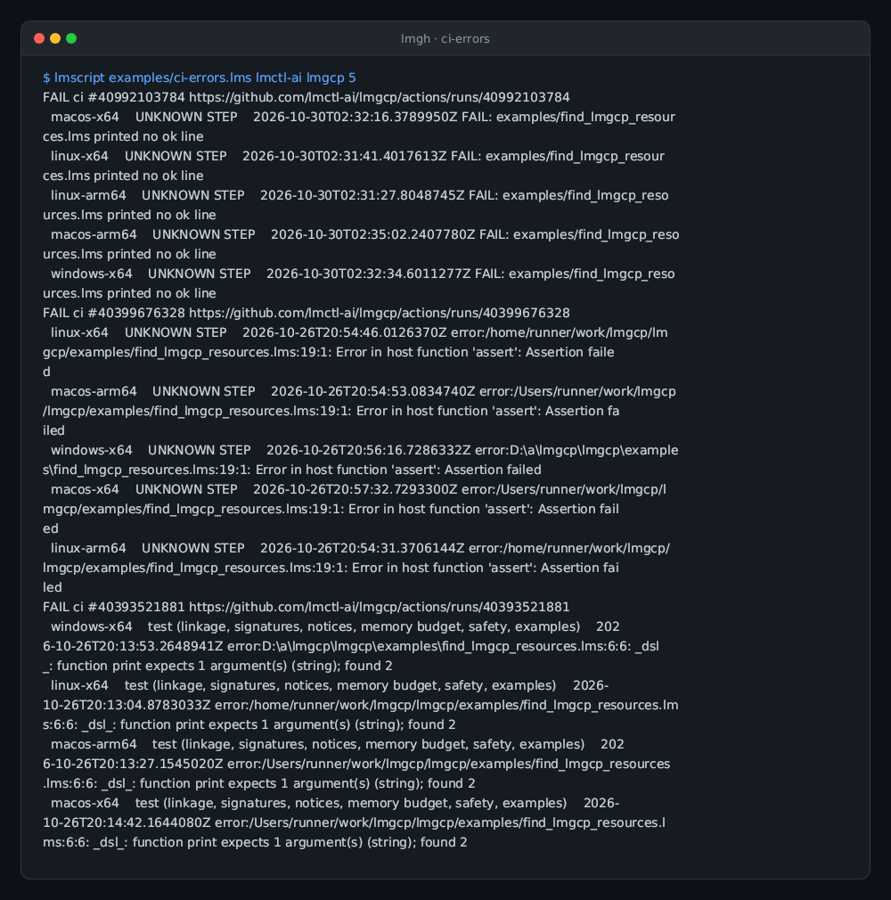
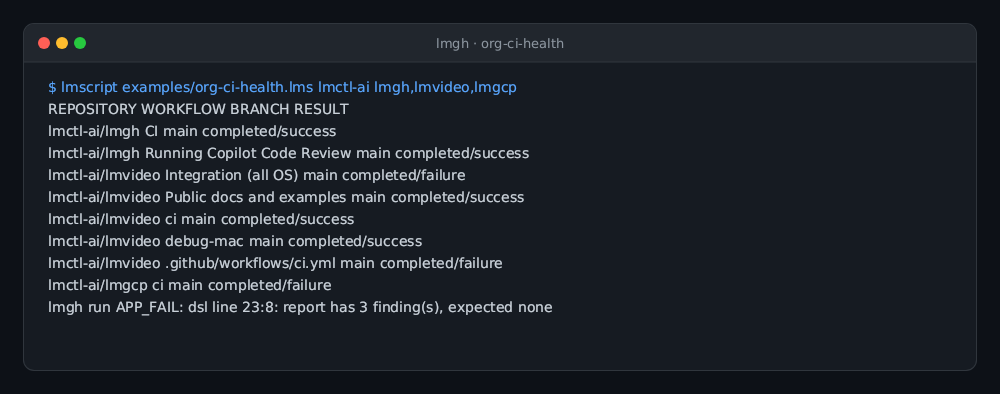
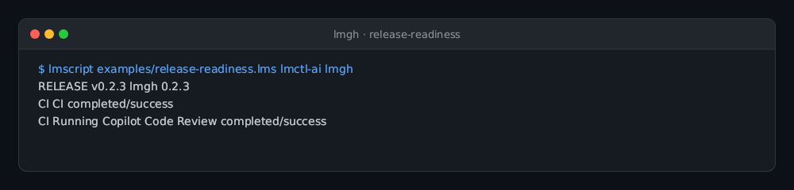
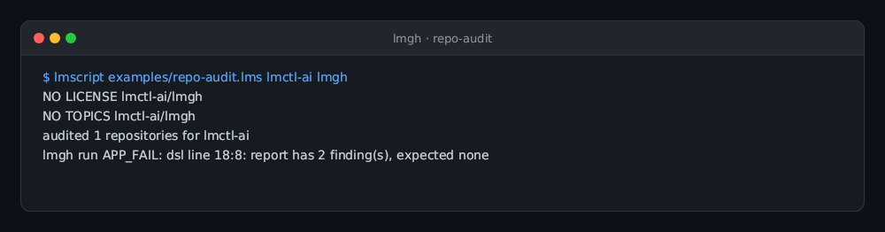
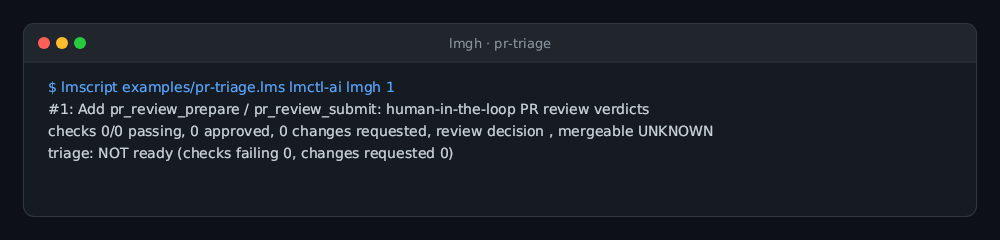
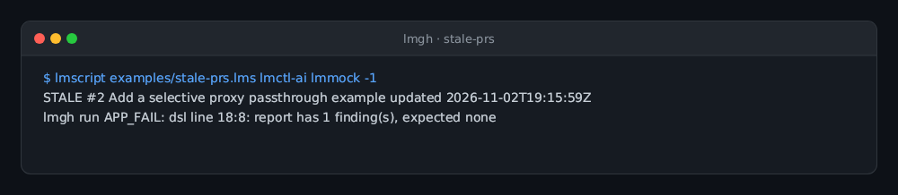

# lmgh — GitHub (`gh`) as an lmcode tool

lmgh is a native host for [lmcode](https://github.com/lmctl-ai/lmcode-go)
bytecode that turns the GitHub CLI (`gh`) into a scriptable, type-checked API:
LMScript source is compiled against the lmgh schema into bytecode, and the
`lmgh` host executes it through `gh` (argv only, prompts disabled), producing
typed `Repo`, `Issue`, `Pr`, `Triage`, `Release` and `Run` objects plus a
`Report` for findings.

This repository is the lmctl-ai fork of [`cli/cli`](https://github.com/cli/cli):
upstream is vendored under `third_party/cli` and pinned by
[`cli.lock`](cli.lock); the lmgh-authored host, schema and examples are MIT
licensed like upstream (see [LICENSE](LICENSE) and
[THIRD-PARTY-NOTICES.md](THIRD-PARTY-NOTICES.md)).

## Use it — no installation

Users do **not** install lmgh and do **not** need Go. A `_lmcode_` block that
names lmgh makes `lmscript` find the host (`lmgh` on `PATH`, or the binary
fetched with `lmscript install github:lmctl-ai/lmgh`), compile against its
embedded schema, and `run_lmcode` executes it:

```lms
owner = ARGV.len() > 0 ? ARGV[0] : "lmctl-ai";
repo = ARGV.len() > 1 ? ARGV[1] : "lmgh";
p = _lmcode_ cli="lmgh";
let prs = gh.pr_list(${owner}, ${repo}, "open", 30);
for (i in range(0, prs.len())) {
  let pr = prs.at(i);
  print("#" + str(pr.number()) + ": " + pr.title() + " (by @" + pr.author() + ")");
}
end _lmcode_
r = run_lmcode(p);
if (!r.ok) { print(r.message); exit(r.code == "APP_FAIL" ? 4 : 3); }
```

```sh
lmscript open-prs.lms <owner> <repo>   # compiles against the host schema and runs it
```

The only runtime requirement is the `gh` binary itself (version >= 2.45.0,
< 3.0.0) with `gh`'s own authentication (`gh auth login` or `GH_TOKEN`). Set
`LMGH_GH` to point at a `gh` that is not on `PATH`.

The schema ([`schema/lmgh.dsl.json`](schema/lmgh.dsl.json)) is the contract:
`lmgh --lmcode-schema` prints the exact embedded bytes and
`lmgh --lmcode-signatures` the host registry. Contexts: `gh: Gh` (the operation
catalog) and `report: Report` (findings log with `write_text`, `write_json`
and `fail_if_any`, which fails with exit 4 / `APP_FAIL` when non-empty).

## Task recipes

[Task recipes](examples/README.md) explain failures, compare default-branch CI
across repositories, find stale/unreviewed PRs, check release readiness, triage
unlabeled issues and audit missing repository metadata. Findings are saved before
exit 4; host/API errors use exit 3. All recipes are read-only on GitHub.

### CI failure log extraction (`ci-errors.lms`)


`lmscript examples/ci-errors.lms lmctl-ai lmgcp 5`

The CI recipe retrieves failed-job logs and reports the first recognized error
per job, rather than stopping at a red run badge. Reports retain run URLs and
job names; scan limits and log heuristics are documented with each recipe.

### Multi-repository default-branch health (`org-ci-health.lms`)


`lmscript examples/org-ci-health.lms lmctl-ai lmgh,lmvideo,lmgcp`

### Release and workflow verification (`release-readiness.lms`)


`lmscript examples/release-readiness.lms lmctl-ai lmgh`

### Repository metadata audit (`repo-audit.lms`)


`lmscript examples/repo-audit.lms lmctl-ai lmgh`

### PR checks and review triage (`pr-triage.lms`)


`lmscript examples/pr-triage.lms lmctl-ai lmgh 1`

### Stale and inactive PR detection (`stale-prs.lms`)


`lmscript examples/stale-prs.lms lmctl-ai lmmock -1`

## Operation catalog (v0)

Reads: `repo_view`, `issue_list`, `issue_view`, `pr_list`, `pr_view`,
`pr_triage`, `release_list`, `run_list`, `search_repos`, `search_issues`,
`search_prs`, `file_text`. `Run.id()` and `run_failed_log(owner, repo, run_id)` expose failed-job logs with
no implicit deadline or byte ceiling; empty or failed log retrievals are errors.
Writes: `issue_create`, `pr_merge`, `issue_close(owner, repo, n, reason)`,
`pr_comment(owner, repo, n, body)`, `label_add(owner, repo, n, label)` and
`release_create(owner, repo, tag, title, notes, draft, prerelease)` — all honor
`gh.dry_run(bool)`, which records intent in the report instead of calling `gh`.

Human-in-the-loop PRs: `pr_prepare(owner, repo, title, body, base, head, draft)`
writes `pr-review-<owner>-<repo>.toml` — a plain TOML file (via
[pelletier/go-toml](https://github.com/pelletier/go-toml)) for the operator to
review and edit; it refuses to overwrite an existing file. Once approved,
`pr_submit(owner, repo, path)` decodes that exact file (unknown fields, an
empty title, or a repository mismatch are refused) and runs `gh pr create`
from it. Nothing reaches GitHub between prepare and submit; `pr_submit` also
honors `gh.dry_run(bool)`. See [`examples/submit-pr.lms`](examples/submit-pr.lms).

Human-in-the-loop PR reviews: `pr_review_prepare(owner, repo, number, event, body)`
writes `pr-review-verdict-<owner>-<repo>-<number>.toml` with `event` set to
`APPROVE`, `REQUEST_CHANGES`, or `COMMENT` (refusing an empty body for
`REQUEST_CHANGES` and `COMMENT`, and refusing to overwrite an existing file).
`pr_review_submit(owner, repo, number, path)` strict-decodes that file,
verifies `owner`/`repo`/`number` and `event`, and runs `gh pr review` with
`--body-file`, honoring `gh.dry_run(bool)`, and returns a `Review` whose `url()`,
`id()` and `state()` come from the review GitHub recorded (`confirmed()` is false,
with the review still posted, if that lookup fails; `summary()` keeps the echo or
dry-run intent). See [`examples/review-pr.lms`](examples/review-pr.lms).

Hand-edited review files are checked for exact-case keys: a key such as `Title`
after `title` is refused rather than silently overriding the value the operator read.

## Develop

```sh
go build -o build/lmgh .   # from a source checkout; needs Go 1.26
scripts/sync-cli.sh        # fetch the pinned cli/cli checkout (third_party/)
./test.sh                  # 85 checks, including 14 offline recipe scenarios
```

Releases: dispatch the CI workflow on `main` with `release=true` to publish the
version declared in `host.go`; CI creates the tag. Existing `v*` tag events also
run the release flow. CI — CI runs `./test.sh`
and, once tests pass, cross-builds the six `lmgh-{linux,macos,windows}-{x64,arm64}`
assets plus `SHA256SUMS` and creates the GitHub release (the asset names follow the lmscript
`install=` convention). Five native runners download and check those assets
and exercise the invocation protocol. No local tagging or publishing is needed. [durable-memory/](durable-memory/) records the design and
decisions.

## Host protocol (v0.3.0)

The Go SDK is pinned by full reviewed SHA in [`sdk.lock`](sdk.lock) and by its
checksummed pseudo-version in `go.mod`/`go.sum`. The host reads lmcode bytecode
(DSLB v6, the current literal format name), exposes only `--lmcode FILE`,
`--lmcode-schema [--json]`, `--lmcode-signatures` and `--version`, and accepts
stable `--first FILE` / `--last FILE` builder roles. Retired flags have no aliases.

`LMCODE_INVOCATION_FILE` selects an absolute-path invocation manifest v1. Its
`dry` field must be boolean; missing or malformed metadata fails with exit 2
before any GitHub process or operation runs. Without the variable, standalone
invocations use argument-order result slots and live mode. In builders, manifest
indices determine result order even when role flags reorder execution.

Dry invocations skip all domain callbacks, including subprocesses, review-file
creation and report writes; the SDK supplies typed primitive/object dummies.
`gh.dry_run(false)` cannot turn an invocation live. The operation-level
`gh.dry_run(true)` remains available in live mode for existing write-intent reports.
Dry reads return dummy data, so dry execution is a policy check, not a GitHub preview.

`$return` supplies the owned per-program result; an omitted result is null.
One terminal `LMCODE_RETURN_BEGIN` / `LMCODE_RETURN_END` frame contains success
results or a structured failure without result data. Exit 0 means success,
2 CLI/manifest failure, 3 load/runtime failure and 4 application failure
(including `report.fail_if_any()` and unreadable input). Builder failures identify
the original manifest part and stop dispatching subsequent programs.

Downstream recipes can pin `install="github:lmctl-ai/lmgh@v0.3.0"` rather than
tracking `latest`. The compiler used in CI is privately installed version 0.2.456.
